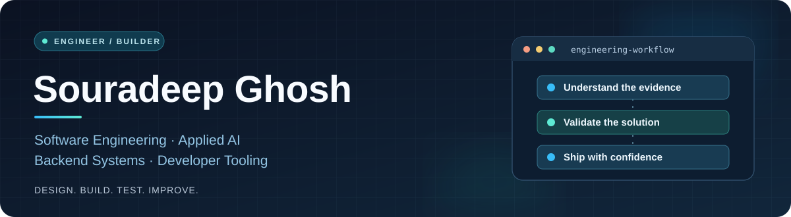

  

   

  **Software Engineer · Applied AI & LLM Systems · Backend / Platform Engineering**

  I build end-to-end software and AI systems with an emphasis on **reliability, explainability, security, and thoughtful product design**.

  

    
    
    
  

  India · B.Tech, Class of 2027 · Interested in software engineering, AI engineering, and backend/platform opportunities

---

## A little about me

I'm **Souradeep**, a software engineer and final-year undergraduate who enjoys turning complex technical ideas into useful, dependable products.

My work sits at the intersection of **software engineering, applied machine learning, and systems design**. I build full-stack applications, agentic workflows, retrieval and evaluation systems, and the backend infrastructure that makes them practical to operate.

What interests me most is the engineering beyond a model call: **how systems handle uncertainty, enforce boundaries, recover from failure, preserve evidence, and remain understandable to the people using them**.

- **Engineering:** APIs, databases, distributed-system fundamentals, testing, deployment, and developer experience.
- **Applied AI:** agent orchestration, retrieval-augmented generation, tool use, model evaluation, and grounded outputs.
- **Problem solving:** algorithms, data structures, and competitive programming.

## Selected engineering work

These projects best represent how I approach engineering problems — from architecture and implementation to safety, usability, and deployment.

### 01 / Base64 Ops — Evidence-first AI developer tooling

**An AI-assisted engineering workflow for investigating CI failures and preparing controlled fixes.**

Instead of giving an agent unrestricted access to modify a repository, Base64 Ops reconstructs the relevant failure state, gathers traceable evidence, proposes a bounded patch, validates it, and requires **explicit approval tied to the exact change** before delivery.

- Repository and CI investigation with revision-aware evidence.
- Constrained patch generation, sandbox validation, and deterministic risk checks.
- Human-in-the-loop approvals, investigation replay, and operational memory.
- Built around secure tool use, auditability, and clearly scoped automation.

**Engineering focus:** Python · FastAPI · LangGraph · React · GitHub Actions · Docker

[**Source code & architecture**](https://github.com/TopoVista/Base64-Ops) · [**Live application**](https://base64-ops.vercel.app/) · [**Technical walkthrough**](https://github.com/TopoVista/Base64-Ops/blob/main/docs/DEMO_SCRIPT.md)

### 02 / Decision Intelligence Agent — From questions to analytical workflows

**A full-stack analytics application that translates business questions into executable, multi-step investigations.**

The system combines intent classification, task planning, SQL generation and correction, database execution, statistical analysis, anomaly detection, and readable insight summaries. It also provides visual dashboards and dataset-oriented workflows.

- Designed an agent workflow that coordinates reasoning with real database operations.
- Built a **Next.js + FastAPI** application with schema exploration and analysis history.
- Separated deterministic analytics and chart construction from optional LLM-powered tasks.
- Added deployment-oriented database configuration and backend API boundaries.

**Engineering focus:** Python · FastAPI · Next.js · PostgreSQL · SQL · Agentic workflows

[**Explore repository**](https://github.com/TopoVista/Ask-Database-Analyst-Agent) · [**Architecture**](https://github.com/TopoVista/Ask-Database-Analyst-Agent/blob/main/docs/ARCHITECTURE.md)

### 03 / TrustLens — Evidence-grounded document intelligence

**A document intelligence workspace designed to make AI-generated answers reviewable.**

TrustLens ingests source material, extracts claims and entities, and presents answers together with the supporting evidence, contradictions, and unresolved questions — rather than asking users to trust a fluent response.

- Built evidence-oriented retrieval, claim tracing, and verification workflows.
- Designed workspace-scoped access, structured answer contracts, and streaming feedback.
- Incorporated evidence health, timeline views, and provenance-oriented intelligence graphs.
- Explored safe fallbacks and the limits of automated factual verification.

**Engineering focus:** FastAPI · React · PostgreSQL · LLM evaluation · Retrieval · Provenance

[**Explore repository**](https://github.com/TopoVista/trustlens) · [**Architecture & implementation**](https://github.com/TopoVista/trustlens/blob/main/docs/architecture.md)

### More things I've built

| Project | What it explores |
| :--- | :--- |
| [**Brain MRI Classification & Analysis**](https://github.com/TopoVista/MRI-Brain-Tumor-Detection-Agentic-AI) | Full-stack computer vision workflow with multiple model predictions, ONNX inference, and optional report-generation stages. Research/decision-support software, not a diagnostic system. |
| [**Healthcare AI Agent**](https://github.com/TopoVista/healthcare-agentic-AI) | LangGraph-based question answering with PubMed-first retrieval, source attribution, and safety-oriented responses. |
| [**Nano-Pass Compiler**](https://github.com/TopoVista/nano-pass-compiler) | Compiler construction experiments in C++, including code-generation artifacts and staged implementation work. |
| [**Agentic AI Design Patterns**](https://github.com/TopoVista/agentic-ai-design-patterns) | Implementations and explanations of agent patterns including planning, routing, human approval, memory, recovery, and evaluation. |

---

## Industry experience

I've contributed to engineering work across **AI-focused product teams and internships**, spanning research prototypes and application development.

- **Applied AI & ML engineering:** Worked with LLM workflows, model experimentation, structured document processing, extraction pipelines, and evaluation.
- **Backend & full-stack development:** Contributed to APIs, product interfaces, data-processing workflows, and integrations between AI components and applications.
- **Domain-specific AI products:** Gained experience designing practical workflows where data quality, correctness, usability, and traceability matter.

*Descriptions are intentionally high-level to respect the confidentiality of internal products and implementations.*

## Tools I work with

| Area | Technologies |
| :--- | :--- |
| **Languages** | Python, C++, TypeScript, JavaScript, SQL, Java |
| **Backend & data** | FastAPI, Node.js, PostgreSQL, Redis, REST APIs |
| **AI / ML** | PyTorch, LangGraph, LangChain, ONNX Runtime, RAG, vector retrieval |
| **Frontend** | React, Next.js, Tailwind CSS |
| **Engineering & delivery** | Git, Docker, GitHub Actions, AWS, automated testing |

I care more about **choosing the right tools and understanding their trade-offs** than collecting frameworks.

## What I'm learning and building next

I'm deepening my understanding of **distributed systems, databases, concurrency, system design, compiler construction, and reliable AI infrastructure**. I'm especially interested in how evaluation, permissions, observability, and human oversight fit into real AI-powered products.

Outside product work, I practice **data structures and algorithms** through competitive programming.

[**Codeforces**](https://codeforces.com/profile/ghshsour) · [**LeetCode**](https://leetcode.com/u/IHihugfgUY/) · [**DSA repository**](https://github.com/TopoVista/DSA)

---

### Let's build something meaningful.

I'm interested in opportunities where I can solve challenging engineering problems, learn from strong teams, and ship software that people actually rely on.

**Recruiter, hiring manager, or engineer?** The easiest way to reach me is via email or LinkedIn. I'd be glad to discuss my projects, engineering decisions, and opportunities to contribute.

Thanks for stopping by — you can explore my pinned repositories for more implementation details.

